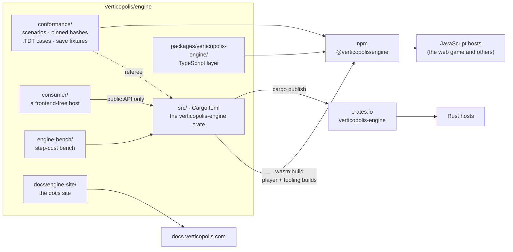
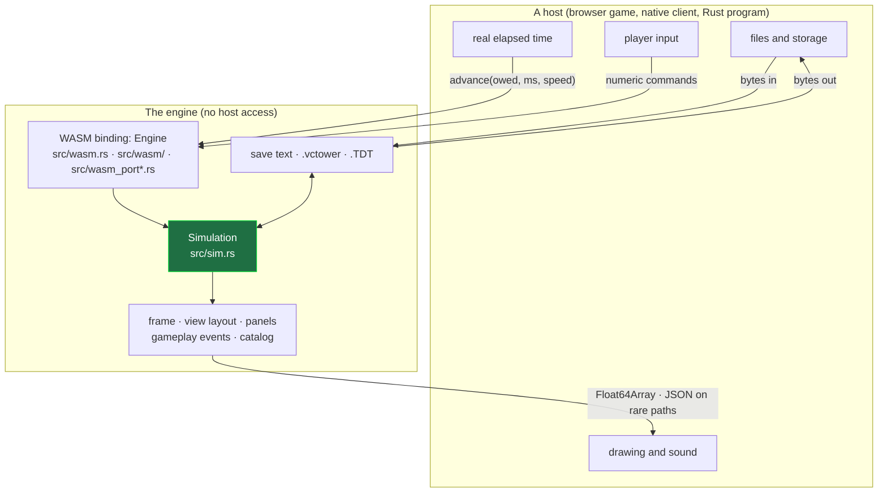
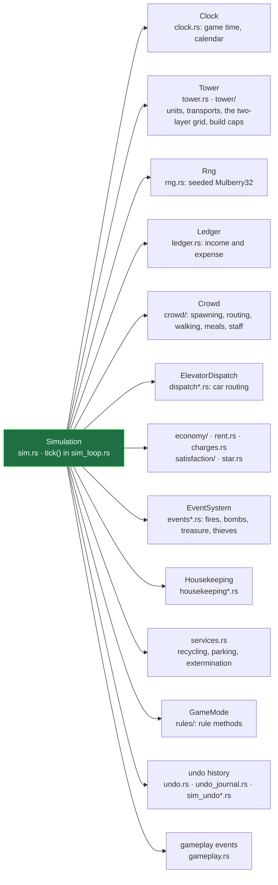
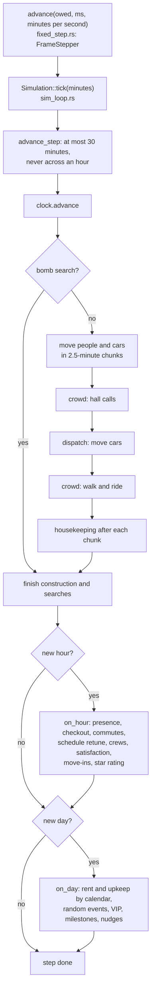
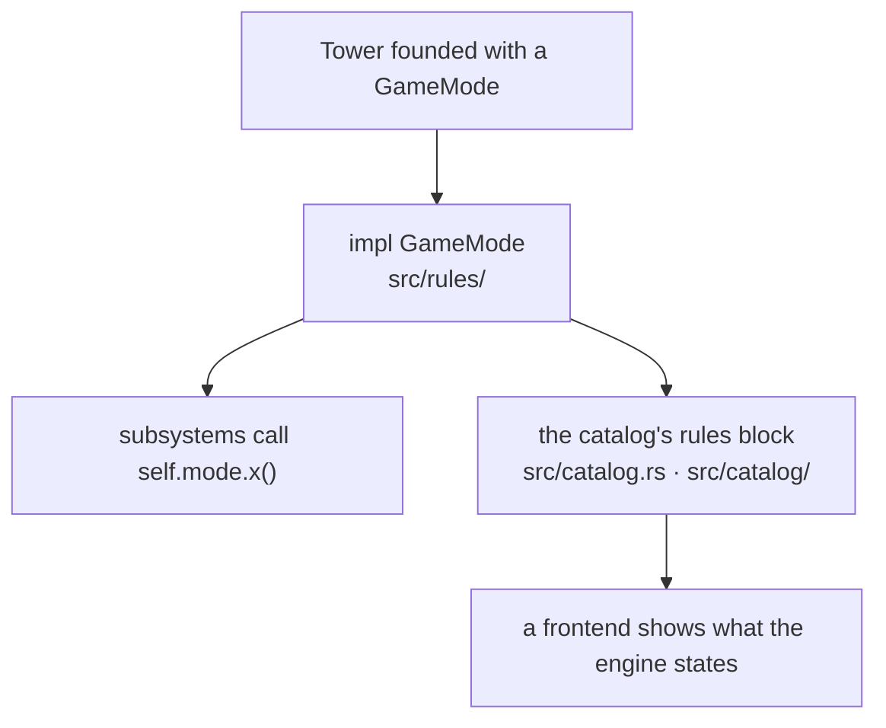
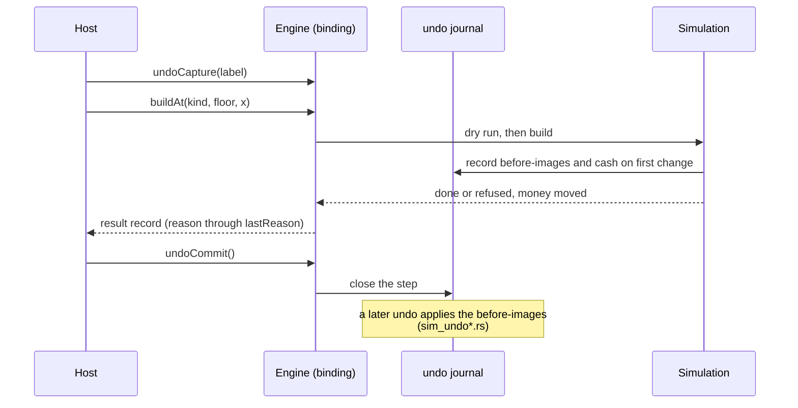
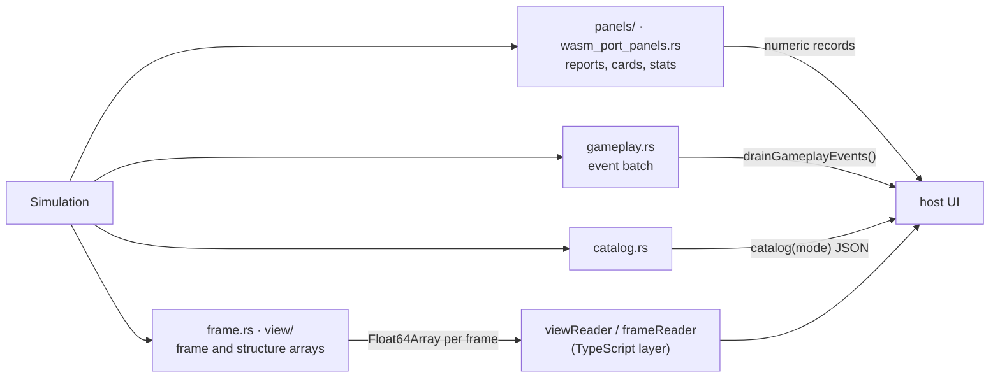
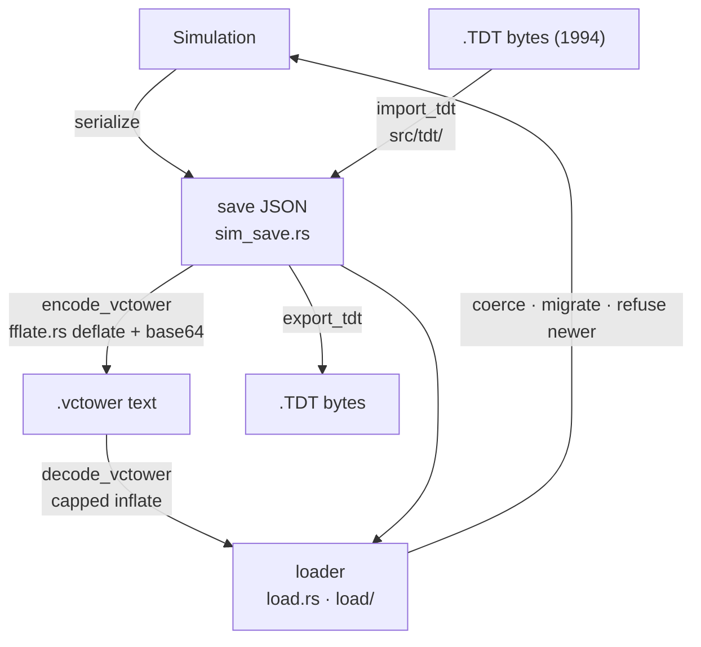
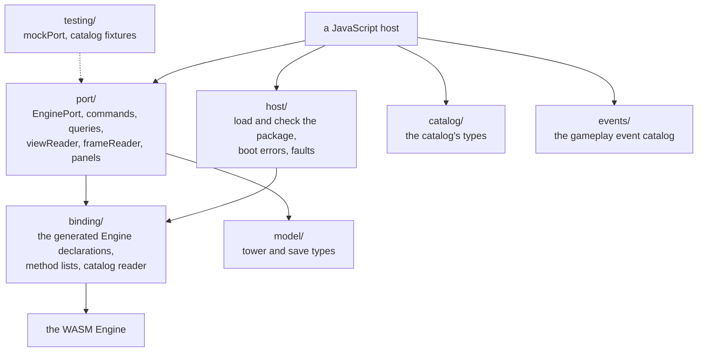
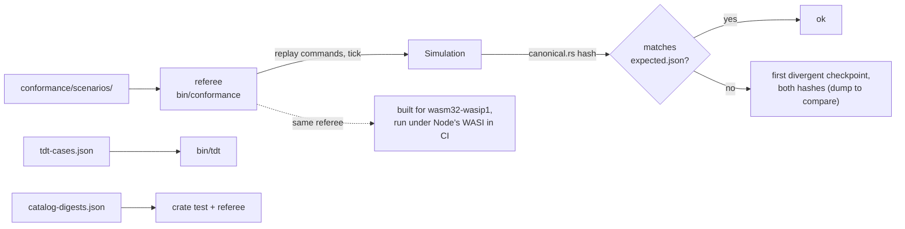

# Architecture

How the Verticopolis engine is put together: what this repository builds,
where the boundary with a host sits, how the simulation steps time, how
Classic and Modern differ, how a command and its undo work, what a host
reads, how a tower is saved, and how the conformance lock holds every host
to the same simulation.

The diagrams are [Mermaid](https://mermaid.js.org/); GitHub renders them
inline. [`docs/engine.md`](docs/engine.md) maps every module in `src/` and
covers the tools, the codecs and the WASM build in detail.
[`API.md`](API.md) lists every call a host makes. A frontend's own
architecture (how it draws, takes input and stores files) lives with that
frontend: the web game's is in
[Verticopolis/web](https://github.com/Verticopolis/web/blob/main/ARCHITECTURE.md),
and the pieces it draws with are in
[Verticopolis/components](https://github.com/Verticopolis/components/blob/main/ARCHITECTURE.md).

## What this repository builds

One Rust crate is the whole simulation. Everything else here packages it,
checks it or documents it.

- **The crate** (`src/`, `tests/`) holds every rule, price, cap, command,
  save format and gameplay event. Its `wasm` feature adds the WebAssembly
  binding; its `conformance` feature adds the referee and the tools.
- **The npm package** carries the player build for the browser (`web/`) and
  Node (`node/`), the tooling build (`tooling/`, with the test and harness
  calls), the conformance suite's files, and the TypeScript layer from
  `packages/verticopolis-engine/`.
- **`consumer/`** depends on the crate by path and uses only the public API.
  CI builds it in a checkout that holds nothing but the crate, `consumer/`
  and `conformance/`, with no Node.js.

## The boundary: the engine never touches the host

The simulation has no access to the DOM, files, the network, the clock, the
console, threads or processes. `tests/independence.rs` fails the build when
the library source reaches for any of them or pulls in an unreviewed crate,
and `tests/read_boundary.rs` keeps the tests and binaries reading only the
crate and `conformance/`. A host passes in everything from outside: the
elapsed time, the seed, the build name and the time stamp on a save.

A Rust host can skip the binding and call `Simulation` and the crate's
public modules directly; `API.md` lists what is stable.

## Inside the simulation

`Simulation` (`src/sim.rs`) owns the tower and its subsystems, each in its
own module. State that is never saved (car dispatch, telemetry, housekeeping
crews, the weather, the renderer's effect counters, the memo caches) is
rebuilt from the saved state on load.

Determinism is part of the contract. The random numbers come from one seeded
generator, maps and sets keep insertion order, and where JavaScript number
semantics reach the hash (`Math.round`, `Number#toString`) `jsmath.rs` spells
them out. The same seed and the same commands give the same tower on every
host, which is what the conformance lock checks.

## One step of time

A host owes the engine the real time that passed. `FrameStepper`
(`src/fixed_step.rs`) turns a frame's milliseconds and the speed into game
minutes, carries the remainder to the next frame and caps the carry, so a
slow frame never snowballs and a tower comes out the same at any frame rate.
`Simulation::tick` (`src/sim_loop.rs`) then breaks the minutes into steps of
at most 30 that never cross an hour boundary.

An open undo gesture is paused around every step, so what time does to the
tower is never part of an undo step.

## Classic vs Modern: the rule-set strategy

A tower is founded under an immutable `GameMode` (`classic` or `modern`).
Behavior the two modes disagree on belongs behind the mode's rule methods
(`impl GameMode` in `src/rules/`, one file per domain). A subsystem calls
`self.mode.<x>()` instead of testing the mode in its own logic, which keeps
mode-specific branches from spreading through the simulation. Classic
follows the 1994 game ([`docs/parity.md`](docs/parity.md) is the checklist);
Modern may use better algorithms and wider limits.

## The catalog

`catalog::catalog(mode)` (`src/catalog.rs`) is the reference data every
frontend draws a build menu, a price label or a placement ghost from: the
world geometry, the economy constants, the pooled caps, and per facility
kind its size, cost, star gate, build cap, transport span, cars, rent
configuration and more, resolved for one mode so a frontend never applies a
rule itself. `canBuild` answers the price and the refusal of one placement
with the same dry run `build` makes first.
`conformance/catalog-digests.json` pins each mode's hash, so a changed price
or size moves the digest in the pull request that changes it.

## Commands and undo

A host sends a build or an edit as a numeric command. The engine checks it,
applies it or refuses it, and answers a result record: done or refused, the
money it moved, and the reason for a refusal (`lastReason`). The host only
shows the answer.

Undo and redo live here too. A gesture opens a journal on its first change
(`src/undo_journal.rs`), and the step it commits holds only what that edit
changed: the before-image of each unit and shaft it touched and the cash it
moved. A step is as big as its edit, whatever the size of the tower. Every
completed swap of the tower (a load, a restore, a new founding) drops the
steps.

## What a host reads

The engine publishes its state as numbers. `viewLayout()` describes, once per
boot, every slot and width of the frame and the codes it uses. Each frame the
host reads a `Float64Array` of the moving parts (people, cars, effects), and
the structure (units and shafts) only when the tower's revision changes.
Panels, reports and the person cards answer numeric records on request.
Gameplay events collect in a batch the host drains
(`drainGameplayEvents`), which is where a frontend's sounds, notices and
analytics come from. JSON stays on rare paths: the layout, saves and loads,
the catalog and tooling.

## Saves and files

The engine writes a tower as save text (`src/sim_save.rs`) and reads it back
through its loader (`src/load.rs` and `src/load/`), which bounds the inflate,
coerces bad values, migrates older saves to the current version
(`load/migrate*.rs`) and refuses a save from a newer build. Saves are
untrusted input: the loader skips units of a kind the catalog does not know
and clamps car counts and shaft spans, so a hand-edited, corrupt or foreign
file loads what it can.

The `.vctower` writer produces the same bytes as the web game's writer for
the same save, stamp and time, and the compressor is a line-for-line port of
the one the web game uses. The 1994 format is written up in
[`docs/tdt/`](docs/tdt/). A host owns where the bytes go: the engine does no
file IO.

## The TypeScript layer

`packages/verticopolis-engine/src/` ships in the npm package beside the
WebAssembly builds, one subpath per module, and imports nothing but the
engine.

`EnginePort` (`port/enginePort.ts`) is the one synchronous, numeric
interface a JavaScript host holds, and the WASM `Engine` class implements it
directly, with no adapter in between. `viewReader` decodes the frame arrays
into records a renderer draws; it decodes and never decides a rule.

## The conformance lock

Frontends may differ. Simulations may not. The referee replays every scenario
in `conformance/scenarios/` and must reproduce every pinned checkpoint hash in
`conformance/expected.json` byte for byte. A change to how the game plays
regenerates the lock in the same pull request.

The same suite ships in the npm package, so any JavaScript host can prove it
runs the real simulation.

## Where to go next

- [`docs/engine.md`](docs/engine.md): the module map, the tools, the codecs,
  the WASM build and the crate version rule.
- [`API.md`](API.md): every call a host makes, and what is stable.
- [`docs/parity.md`](docs/parity.md): how a Classic tower matches the 1994
  game, and [`docs/canon/`](docs/canon/) for the dated rule audits.
- [`docs/tdt/`](docs/tdt/): the 1994 `.TDT` format.
- [`conformance/README.md`](conformance/README.md): the lock and how to
  regenerate it.
- [`CONTRIBUTING.md`](CONTRIBUTING.md): pull requests, change notes and
  releases.
- [docs.verticopolis.com](https://docs.verticopolis.com): the crate and
  JavaScript guides.
